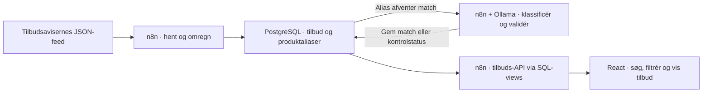

# DealScout

Dagligvaretilbud kommer fra flere kæder med forskellige varenavne og pakkestørrelser. DealScout samler tilbuddene ét sted, gør dem søgbare og regner fx en bakke blommer på 500 g til 15 kr. om til 30 kr./kg. Det gør det muligt at sammenligne tilbud på tværs af butikker.

## Mit tekniske bidrag

Jeg byggede dataflowet fra indsamling til søgning. Indsamlingen bruger et sideopdelt JSON-feed og opdaterer tilbud på nøglen kæde + eksternt tilbuds-ID. Jeg adskilte den faste beregning af enhedspris fra fortolkningen af varenavne. PostgreSQL gemmer den oprindelige tilbudstekst, mens Ollama foreslår type, kategori og sammenligningsgruppe for hvert produktalias.

Jeg validerer modelforslag i kode, før de kan bruges til sammenligning. Usikre eller ugyldige match får status `review`, og blandede tilbud markeres `multi_product`. SQL-views bruger matchede tilbud og skelner mellem annoncens førpris, prishistorik og aktuelle priser på tværs af kæder. API'et bruger bundne SQL-parametre til søgning, filtre og paginering.

## Se koden

| Del | Hvad eksemplet viser |
| --- | --- |
| [Indsamling](workflows/scraper-workflow.json) | Sideopdeling, omregning til enhedspriser og opdatering af tilbud og aliaser. |
| [Produktnormalisering](workflows/normalize-grocery-products.json) | Ventende aliaser i batches, struktureret Ollama-svar og regelbaseret validering. |
| [Tilbuds-API](workflows/grocery-offers-api.json) | Webhook, validering af filtre og et pagineret JSON-svar fra PostgreSQL. |
| [PostgreSQL-skema](database/schema.sql) | Kernetabeller, nøgler og views til deduplikering, prissammenligning og API. |
| [Ét tilbud gennem flowet](examples/offer.json) | Syntetisk råtilbud, normaliseret alias og eksempel på svaret ved søgning efter `blommer`. |

API'et returnerer kildens varenavn i `product_name` sammen med udledt type, kategori og sammenligningsgruppe. Den oprindelige frontend sender søgeord og filtre til API'et og bruger `pagination` til sideskift.

## Portfolio-kopi og lokal opsætning

Repoet indeholder tre inaktive n8n-eksempler, SQL og syntetiske data. Indsamling og normalisering har manuelle triggere. Til lokal afprøvning skal du oprette en PostgreSQL-database med skemaet, tilknytte en lokal databaseforbindelse i n8n og erstatte demo-adresser og kæde-ID'er. Normaliseringen kræver Ollama med modellen `qwen3:8b`. Frontend og deployment ligger uden for portfolio-kopien.
